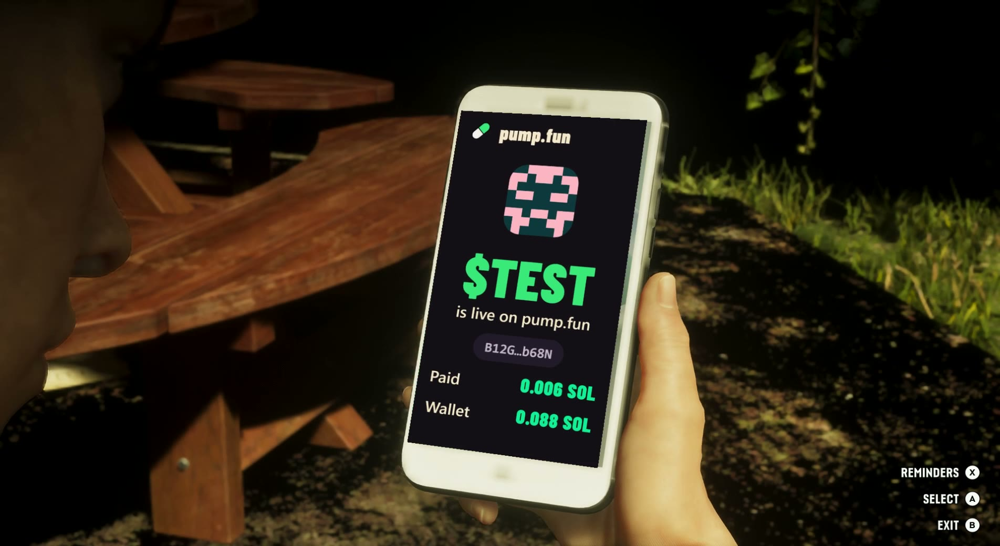
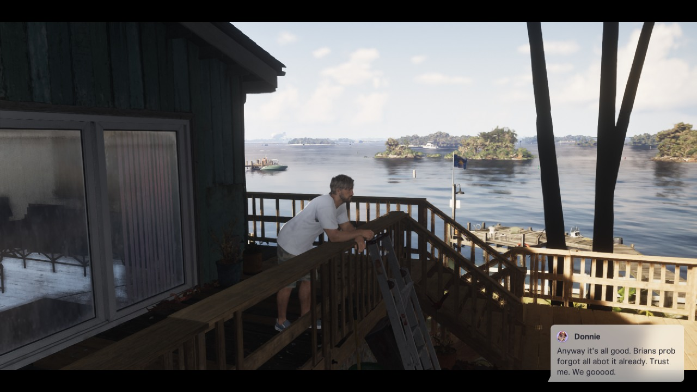

# Vicewire proof

**$VICEWIRE CA** (Solana): [`viCEWiReoWxwmRRfGmWmpP1FFdB8Jm8PzZChVJ9dvg6`](https://solscan.io/token/viCEWiReoWxwmRRfGmWmpP1FFdB8Jm8PzZChVJ9dvg6)

[Run the Vicewire companion](https://github.com/VicewireLabs/vicewire) or [pick a contribution](https://github.com/VicewireLabs/vicewire/blob/main/CONTRIBUTING.md). The companion source is available under Apache-2.0.

Vicewire is a private single-player GTA VI prototype that runs on real Solana. On November 27, 2026, a wallet held by the game paid **0.006034 SOL** on Solana mainnet to create a coin on Pump.fun from the in-game phone, and then did it a second time. Both transactions are finalized and anyone can check them below. Story Mode missions still award ordinary game cash. A mission that pays SOL, proof that a player controls a paired wallet, and deposits from $VICEWIRE creator fees are future integrations.

## Real SOL on mainnet



[Watch the 24-second launch](media/phone-launch.mp4). Lucia takes out her phone, the Pump.fun app opens with the cost and the wallet's balance, the coin is created and the receipt appears, all inside the running game.

| | First launch | Second launch (filmed above) |
|---|---|---|
| Transaction | [58gcp51a…WDhP8y](https://explorer.solana.com/tx/58gcp51aPZpPuXPHGCeiau1BTYht2yvP6fVo6fG8QrscefbLXFSsikqFQ7mmh72RiBMTExZeWLrjELQYYsWDhP8y) | [63bYBhSH…xNrpi](https://explorer.solana.com/tx/63bYBhSHcB7GXxQCdAdj3Esn25HAviS35bEs7veSgWBHii4sKCzCDwNA8GfvRyqFG9EJkt2nY3TbpBwgFSGxNrpi) |
| Coin created | [B6San66b…X1krf](https://explorer.solana.com/address/B6San66b2qPkfyJiKJakTrWgor977hQjPxbKpvAX1krf) | [B12GArt1…gb68N](https://explorer.solana.com/address/B12GArt1RteF2Cm2eAzCkP9revY65drbozfYM37gb68N) |
| Finalized slot | 474740541 | 474741563 |
| Paid by the game wallet | 6,034,320 lamports | 6,034,320 lamports |
| Network fee inside that | 45,000 lamports | 45,000 lamports |
| Wallet balance before and after | 0.099595 to 0.093561 SOL | 0.093561 to 0.087526 SOL |

The game wallet is [A2ZZMvo9…Cn27i](https://explorer.solana.com/address/A2ZZMvo9MntHWkYjwwbVGVMBJBkPxXMHNxTnn9SCn27i). It was funded with real SOL, it is the fee payer on both transactions, and its key stays on the player's PC. Each coin is named "test" with the ticker TEST and was created with no first buy. These are test coins made to prove the path. They are not the Vicewire token.

Check both with Python 3.11 or later. The live verifier reads Solana's public mainnet RPC. It confirms the network, signature, slot, fee payer, signers, fee and balance change, and that the only program work in each transaction is one Pump.fun coin creation. It needs no wallet, credentials or third-party packages.

```sh
python verify_mainnet.py --live
python verify_mainnet.py
```

The second command checks the bundled transactions ([first](evidence/mainnet-launch-1.json), [second](evidence/mainnet-launch-2.json)) against the [launch summary](evidence/mainnet-launches.json).

## Custom Solana apps in the game

| App | What it does today | Evidence |
|---|---|---|
| Vicewire | The game's own payment app carries the Vicewire name and palm mark on the phone's home screen. The texture and label changes are installed in the game's files. | [Phone home screen](media/phone-home.jpg) · [Install record](evidence/brand-install.json) |
| Pump.fun launcher | Quotes the cost by simulating the transaction, shows the wallet's balance, creates the coin when confirmed and shows the receipt. A signer that refuses anything except one coin creation for the confirmed coin, under a spending limit of 0.02 SOL, approves each launch. | [Create screen](media/phone-launch-create.png) · [Receipt screen](media/phone-launch-receipt.png) · [In the game](media/phone-launch-create-in-game.jpg) |
| Wallet companion | Pairs a public address and reads its balance beside the game. | [Companion preview](media/wallet-companion.jpg) · [Pairing results](evidence/wallet-pairing.json) |

How the launch film was made: the phone opens by a real controller press and the home screen is the game's own. The Pump.fun tile, its app and the receipt are drawn onto the phone by the Vicewire plugin, and the script that films the run moves onto the tile and presses its buttons. The coin, the cost, the wallet and the receipt are real. A Pump.fun tile that the game's own phone menu selects is the next step.

## Devnet payout rehearsal

Earlier the same day, a simulated delivery paid **0.002 test SOL** to a newly generated player wallet on Solana devnet. The treasury used faucet funds.

[Open the finalized transaction in Solana Explorer](https://explorer.solana.com/tx/44XwNDhiLtd5k3iNzgRJmwYjYqukPJwNH4a4QHpML38rvFYJMgp2En7JnSh7ta3aNNCXCLqobCvCqcqGxMmra6hL?cluster=devnet). At slot **526954858**, the player gained **2,000,000 lamports** and the treasury spent **2,005,000 lamports**, including the **5,000-lamport network fee**.

Run either command from this directory with Python 3.11 or later. The live verifier reads Solana's public devnet RPC. It checks the network, signature, slot, transfer program, sender, recipient, amount, fee and both balance changes. It needs no wallet, credentials or third-party packages.

```sh
python verify.py --live
python verify.py
```

The second command checks the [bundled transaction](evidence/finalized-transaction.json). The [rehearsal record](evidence/devnet-rehearsal.json) describes the application-side test. Four concurrent reports supplied different candidate blockhashes and obtained one signed transfer. The harness discarded the submission acknowledgement. A fresh process recovered the finalized receipt from the journal. A repeat report returned the same receipt. The chain independently establishes the transfer and balance changes. The concurrency and restart results come from the harness.

## Windows PC capture



[Watch the outdoor scene](media/pc-scene.mp4) or [view a separate save-menu capture](media/pc-save-menu.jpg). These came from the game renderer of an emulated console build on Windows. We sampled 60 game-only frames over 11.7 seconds at a target of five captures per second. The clip is silent.

The renderer logged **22 samples** from startup through the outdoor scene. The samples ranged from **2.6 to 30.2 FPS**, with a median of **21.0 FPS**. Seven reached at least 30 FPS. The two samples ending during this clip measured **19.6** and **18.8 FPS**. Each row in the [renderer CSV](evidence/pc-renderer-samples.csv) includes its UTC time and whether it fell inside the capture window. [Capture timing and summary](evidence/pc-run.json)

## Wallet, checkout and branding

| What we tested | Observed result | Evidence |
|---|---|---|
| Read-only wallet pairing | A Wallet Standard browser fixture recovered after connection rejection, preserved pairing after reload and required a new selection after account changes. It requested no wallet signature. | [Pairing results](evidence/wallet-pairing.json) · [Companion preview](media/wallet-companion.jpg) |
| Public devnet balance | The companion and CLI agreed on a finalized public account balance within the recorded slot window. This was a watch-address check. | [Balance comparison](evidence/devnet-balance-read.json) |
| Local merchant checkout | A test signer paid 0.1 SOL to the merchant plus a 0.002 SOL service fee. Four verifiers credited a single companion entitlement, which survived a restart. | [Local checkout](evidence/local-checkout.json) |
| Devnet checkout simulation | An unsigned checkout simulation succeeded. This exercise issued no customer payment. | [Simulation](evidence/devnet-checkout-simulation.json) |
| Purchase panel | The SDK simulator rendered quote and status fixtures. A signed player purchase and a native game entitlement remain unverified. | [Simulator states](evidence/purchase-panel.json) |
| Vicewire name and palm artwork | The clone's install check recorded 31 texture targets and 1,278 changed labels across 139 independently decoded tables, including 127 English labels. The art board shows decoded assets. The unlocked in-game bank screen still needs a capture. | [Install record](evidence/brand-install.json) · [Native-size crops](media/native-asset-crops.png) |

## Reproduce the replay test locally

The public harness creates two temporary identities and uses only faucet funds on a loopback validator. It requests four distinct blockhashes, prepares the same mission concurrently, submits one transfer, reopens its journal in another process and checks finalized transaction history and balances. Local signatures vary on each run.

With Python 3.13 and a local Solana test validator installed, start a fresh validator in its own directory. In another terminal:

```sh
python -m venv .venv
# Activate .venv using your shell's normal activation command.
python -m pip install -r requirements.txt
python -m unittest discover
python rehearse_local.py
```

The default validator port is 8899. If your validator uses another loopback port, pass it with `--port`. The [original local run](evidence/local-rehearsal.json) and a [fresh run of this published harness](evidence/local-reproduction.json) each produced one finalized player credit. The separate private bridge suite passed 41 tests at the milestone. Only the self-contained proof tests are included here.

## Intro film

[Watch the 14-second Vicewire intro](media/vicewire-intro.mp4). This is a promotional animation with original illustrations, titles and music. The launch film, PC capture and transactions above are the evidence.

[File checksums](SHA256SUMS) cover the published evidence, media and verifier files.
